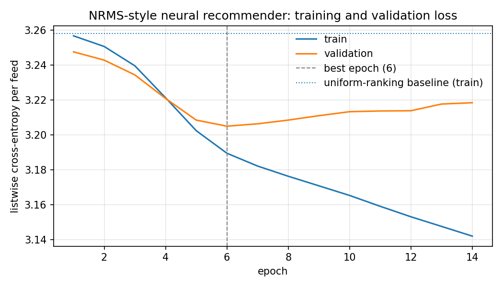

# Week 3 evidence (working draft, 19 November 2026)
Everything below is rebuilt from the full IDEA dataset with two commands:
```
python -m agora.build --idea-dir data/raw/Datasets/IDEA/dataset
python -m agora.experiment --split validation
```
The test split has not been evaluated: models, lambda and targets were selected on validation only. Full tables, lambda sweep and reader examples: [experiment_validation.md](experiment_validation.md).

## Models
- **Neural recommender (served by the API), NRMS-style** (`src/agora/models/neural.py`, 43,496 trained parameters):
  - news encoder: TF-IDF+SVD text vector, topic and outlet embeddings;
  - user encoder: multi-head self-attention over the last 50 training reads, then additive attention pooling;
  - Wide & Deep click predictor over the user-article interaction and three reader-specific signals: content similarity, topic affinity, outlet affinity;
  - trained with a listwise softmax loss per feed;
  - a position-bias tower (PAL, Guo et al. 2019) absorbs the display-position effect during training and is dropped at recommendation.
- **Logistic regression** (`src/agora/models/relevance.py`): baseline on content similarity, topic affinity and article popularity.

Reader-independent signals (freshness, topic and outlet popularity) are left out of the neural model by default. On validation, adding them lowered NDCG@10 (0.389 vs 0.405) without making the lists more personal.

## Q1 Training


- **Neural model:**
  - trained on 2,916 training feeds (75,790 candidate rows);
  - validation loss falls from 3.247 to 3.205 at epoch 6 (uniform-ranking baseline 3.258), then rises slowly; early stopping (patience 8) keeps epoch 6;
  - no NaN; runs are deterministic (seed 42).
- **Logistic baseline** (`loss_curves.png`):
  - 388 epochs, validation log loss 0.4148, against a prevalence baseline of 0.4247;
  - the validation loss never rises.

## Q2 Sanity floor (validation, 1,106 of 1,620 feeds have at least one read)
| Ranking | NDCG@10 | Recall@20 | IPS-NDCG@10 |
| --- | --- | --- | --- |
| Random | 0.3091 | 0.7778 | 0.2713 |
| Most popular (topic popularity in training) | 0.3238 | 0.7982 | 0.3029 |
| Logistic regression | **0.4097** | **0.8518** | 0.3511 |
| Neural (NRMS-style) | 0.4053 | 0.8368 | **0.3600** |

Both models beat random and most-popular on every metric. Between the two models the difference is within noise, by paired bootstrap:
- NDCG@10: -0.004, 95% CI [-0.021, +0.012];
- IPS-NDCG@10: +0.009, 95% CI [-0.007, +0.024].

**Correction to an earlier draft:** article-level popularity is not a usable baseline here. None of the validation candidates was read during training: they are new articles, so all their popularities are 0. The previous "most popular" figure (0.4043) was the tie-break on article IDs, which follow the order in which articles were collected. Popularity is therefore measured by topic.

**Position bias.** Readers mostly read what the app displayed at the top; IDEA's original display order alone scores 0.508 NDCG@10. IPS-NDCG weights each read by 1 / P(seen | position), with propensities estimated on the training split, so that a ranking is not rewarded for copying the old display order.

## Sanity check: personalisation
Several readers received the same 26 candidates on the same day (6 candidate sets, 884 feeds). The mean top-10 overlap between them shows how personal the lists are (Jaccard index; 1 = everyone gets the same list):

| Ranking | Top-10 overlap between readers |
| --- | --- |
| Random | 0.25 |
| Logistic regression | 0.49 |
| Neural | 0.82 |
| Neural + SCRUF-D | 0.80 |
| Most popular | 1.00 |

**Limitation:** the neural model is much less personal than the logistic baseline. It mostly learned which articles appeal to everyone; the article embeddings carry most of the score, the reader's history little.

For today's articles the API adds a personal candidate-generation stage (closest article of every topic, then closest overall; 26 articles), then ranks it. On 558 articles of 19 Nov 2026, the top-10 overlap between 8 readers is 0.12.

Three readers before and after SCRUF-D: [experiment_validation.md](experiment_validation.md).

## Q3 Leakage
- **Temporal split** in local time (Europe/Amsterdam, verified against epoch timestamps): train 23–29 Nov, validation 30 Nov–2 Dec, test 3–7 Dec 2023.
- **Profiles and popularity** use training reads only: histories, topic/outlet affinity, topic popularity and the IPS propensities. Validation and test profiles are frozen at the end of training.
- **Validation labels** serve only for loss curves, early stopping, model choice and lambda.
- **Test labels** are never read by a model. `predict --split test` and `agora.experiment --split test` refuse to run unless the model is frozen.
- **Article text vectors** use article text only, no interaction.
- **Topics:** IDEA's 300+ categories are mapped to 12 topics by fixed rules (`src/agora/data/idea.py`); Sky News' "home" section is front-page news (uk_news).

## Q4 Innovation proof (validation, neural model)
Own metric: position-weighted top-10 exposure of the protected topic (politics, agent `public_affairs`), compared with its share of the candidates (8.2%). Ablation: lambda = 0.

| | NDCG@10 | IPS-NDCG@10 | Politics top-10 exposure |
| --- | --- | --- | --- |
| Ablation (lambda 0) | 0.4053 | 0.3600 | 0.071 |
| SCRUF-D (lambda 0.25) | 0.4005 | 0.3556 | **0.093** (target 0.082 reached) |


The logistic baseline gives politics only 0.043 of top-10 exposure.

## Q5 Live system
- **API:** `GET /mode` reports the NRMS model and SCRUF-D (`is_mock: false`). `/recommend` takes about 60 ms per IDEA feed; `/recommend_live` takes about 25 ms on today's articles. Both are well under 2 s.
- **Recent articles:**
  - `python -m agora.data.live` fetched 558 articles from the RSS feeds of IDEA's 6 outlets on 19 Nov 2026 (`configs/live_sources.json`);
  - the model scores them with the saved text encoder, without retraining, after the personal candidate-generation stage; SCRUF-D then reranks them;
  - the interface offers "Today's news" next to the IDEA feeds.
- **Interaction logging:** Streamlit interface → API → SQLite. Displays and clicks are stored and listed with `GET /interactions`.
- To add: the two interface screenshots (today's news list; stored click).

## Pending
- Q6: clean-machine launch by a member who did not write the code, timed, following the README only.
- Test split: freeze both models (`python -m agora.models freeze`), then run `python -m agora.experiment --split test` once.
- Q7 and the global risk level: team.
