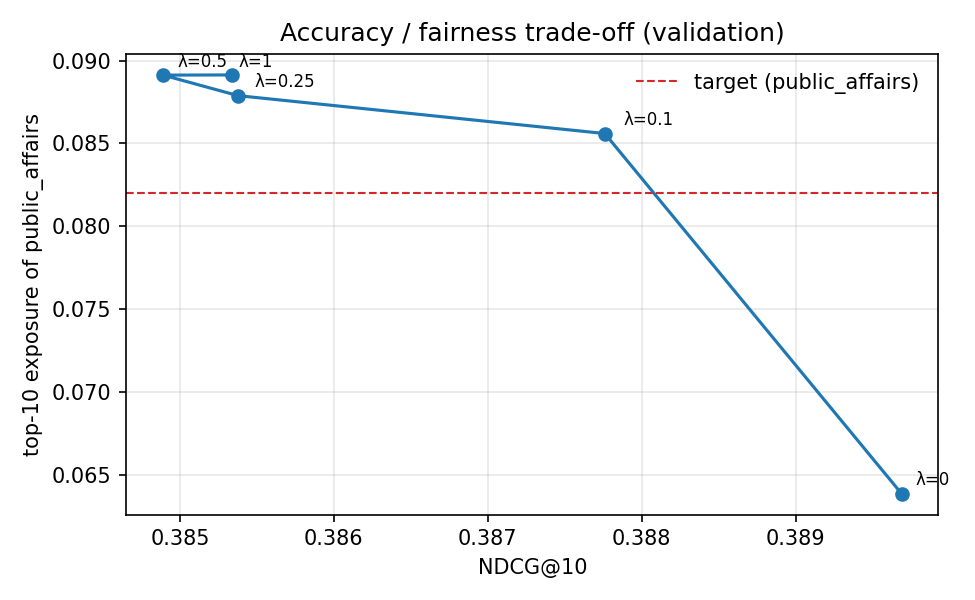
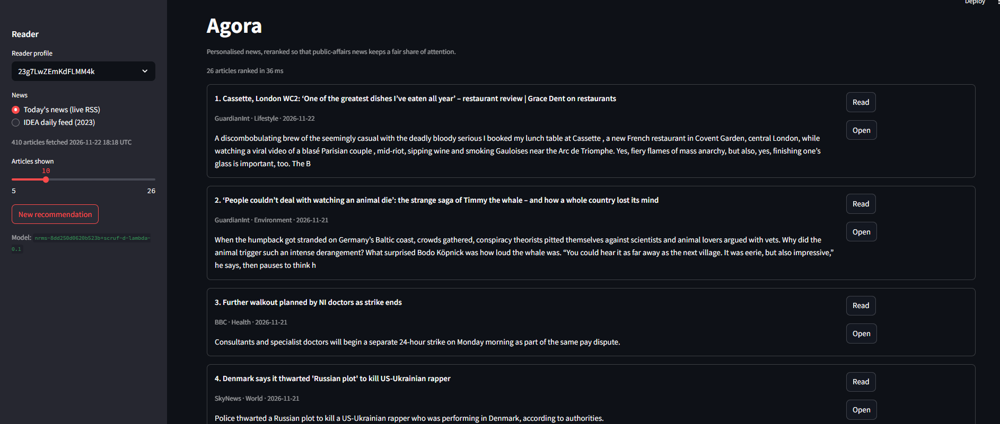
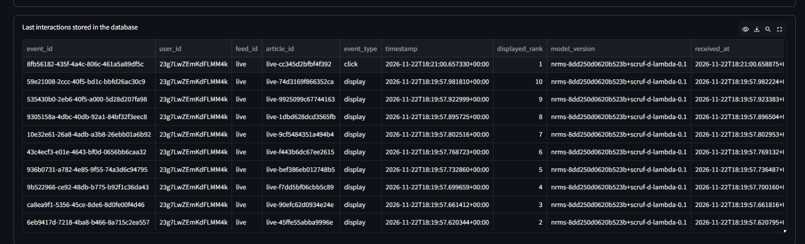

# Week 3 evidence (22 November 2026)
Everything below is rebuilt from the full IDEA dataset with two commands:
```
python -m agora.build --idea-dir data/raw/Datasets/IDEA/dataset
python -m agora.experiment --split validation
```
Sections Models to Q4 report **validation** figures: models, lambda and targets were selected on validation only, then frozen. The test split was evaluated once afterwards: see "Test results". Full tables, lambda sweep and reader examples: [experiment_validation.md](experiment_validation.md) and [experiment_test.md](experiment_test.md).

## Models
- **Neural recommender (served by the API), NRMS-style** (`src/agora/models/neural.py`, 43,496 trained parameters):
  - news encoder: TF-IDF+SVD text vector, topic and outlet embeddings;
  - user encoder: multi-head self-attention over the last 50 training reads, then additive attention pooling;
  - Wide & Deep click predictor over the user-article interaction and three reader-specific signals: content similarity, topic affinity, outlet affinity;
  - trained with a listwise softmax loss per feed;
  - a position-bias tower (PAL, Guo et al. 2019) absorbs the display-position effect during training and is dropped at recommendation.
- **Logistic regression** (`src/agora/models/relevance.py`): baseline on content similarity, topic affinity and training popularity.
- **Text encoder:** TF-IDF+SVD fitted only on the 5,596 articles published before the end of training (29 Nov 2023, 24:00 Amsterdam time), then applied to every article. No later text shapes the vocabulary.

Reader-independent signals (freshness, topic and outlet popularity) are left out of the neural model by default. On validation, adding them lowers NDCG@10 (0.392 vs 0.413) and does not make the lists more personal (top-10 overlap 0.82 vs 0.85).

## Q1 Training


- **Neural model:**
  - trained on 2,916 training feeds (75,790 candidate rows);
  - validation loss falls from the uniform-ranking baseline 3.258 to 3.204 at epoch 6, then rises slowly;
  - stop reason (`neural_report.json`): validation loss not improved by 1e-4 for 8 epochs, weights of epoch 6 kept;
  - no NaN; runs are deterministic (seed 42).
- **Logistic baseline** (`loss_curves.png`):
  - validation log loss 0.4168, against a prevalence baseline of 0.4247;
  - stop reason (`training_report.json`): converged after 382 epochs, improvement below 1e-5 for 50 epochs; the last epoch is the best and the validation loss never rises.

## Q2 Sanity floor (validation)
1,106 of the 1,620 validation feeds are evaluated. 514 feeds are excluded because their reader read nothing within 24 hours, so they have no positive; the count is reported with every result (`excluded_zero_positive_feeds`).

| Ranking | NDCG@10 | Recall@20 |
| --- | --- | --- |
| Random | 0.3091 | 0.7778 |
| Most popular (article, training reads) | 0.4043 | 0.8040 |
| Topic popularity (training, seeded random tie-break) | 0.3251 | 0.7904 |
| Logistic regression | **0.4231** | **0.8652** |
| Neural (NRMS-style) | 0.4127 | 0.8324 |

Paired bootstrap as declared in `docs/test_protocol.md` (`python -m agora.evaluation.bootstrap`, 2,000 resamples of the 484 readers, a reader's feeds stay together, seed 42), 95% CI:

| Comparison | NDCG@10 | Recall@20 |
| --- | --- | --- |
| Neural − random | +0.104 [+0.087, +0.119] | +0.055 [+0.035, +0.072] |
| Neural − most popular (article) | +0.009 [−0.009, +0.026] | +0.028 [+0.011, +0.046] |
| Neural − topic popularity | +0.088 [+0.073, +0.102] | +0.042 [+0.023, +0.060] |
| Logistic − most popular (article) | +0.019 [+0.001, +0.037] | +0.061 [+0.044, +0.078] |
| Logistic − topic popularity | +0.098 [+0.079, +0.115] | +0.075 [+0.058, +0.094] |
| Neural − logistic | −0.010 [−0.026, +0.006] | **−0.033 [−0.048, −0.018]** |

- Both models clearly beat random and topic popularity.
- **Article-level most popular is a strong floor.** No candidate was read during training, so all its scores are 0 and the order is the tie-break on article IDs, which follow publication time: it ranks the oldest article first. That order alone reaches 0.404 NDCG@10. The neural model does not beat it in NDCG@10 (interval includes 0), only in Recall@20; the logistic baseline beats it narrowly. Why is not established yet (one hypothesis: older articles had more time to be read). It ignores the reader, so it is a floor to beat, not a recommender.
- Neural vs logistic: no difference on NDCG@10; on Recall@20 the **logistic baseline is significantly better**. The team keeps the neural model as primary (decision of 22 Nov) for the course's complex-model requirement, not because it wins on validation.

## Sanity check: personalisation
Several readers received the same 26 candidates on the same day (6 candidate sets). The mean top-10 overlap between them shows how personal the lists are (Jaccard index; 1 = everyone gets the same list):

| Ranking | Top-10 overlap between readers |
| --- | --- |
| Random | 0.25 |
| Logistic regression | 0.42 |
| Neural | 0.85 |
| Neural + SCRUF-D (lambda 0.1) | 0.82 |
| Topic popularity | 0.94 |
| Most popular (article) | 1.00 |

**Limitation:** the neural model is much less personal than the logistic baseline. It mostly learned which articles appeal to everyone; the article embeddings carry most of the score, the reader's history little.

For today's articles the API adds a personal candidate-generation stage (closest article of every topic, then closest overall; 26 articles), then ranks it. On 558 articles of 19 Nov 2026, the top-10 overlap between 8 readers was 0.12 (measured before the encoder was refitted on past articles; to re-measure).

Three readers before and after SCRUF-D: [experiment_validation.md](experiment_validation.md).

## Q3 Leakage
- **Temporal split** in local time (Europe/Amsterdam): train 23–29 Nov, validation 30 Nov–2 Dec, test 3–7 Dec 2023.
- **Time zone of the raw timestamps:** UTC+1 throughout (no clock change in the period). `python -m agora.data.verify_timezone --idea-dir data/raw/Datasets/IDEA/dataset` matches each read with the closest article page view (epoch time): 34,763 of the 34,871 matched reads (99.7%) are 1 hour apart once rounded to the hour.
- **Profiles and popularity** use training reads only: histories, topic/outlet affinity, topic popularity and the position propensities. Validation and test profiles are frozen at the end of training.
- **Article text vectors:** the encoder is fitted on articles published during training only (5,596 articles); it never sees validation or test text when building its vocabulary.
- **Validation labels** serve only for loss curves, early stopping, model choice and lambda.
- **Test labels** are never read by a model; see the test protocol below.
- **Build checks** (`data/processed/cleaning_report.json`): the build stops if a candidate or a read is missing from the article catalogue (0 of each), or if two feeds share an identifier. It also reports reads outside the experiment (0), invalid publication dates (0), missing values (4 articles without a lead) and eligible readers without a feed per split (0, 0, 27 in test).
- **Topics:** IDEA's 300+ categories are mapped to 12 topics by fixed rules (`src/agora/data/idea.py`); Sky News' "home" section is front-page news (uk_news).

## Q4 Innovation proof (validation, neural model)
Own metric: position-weighted top-10 exposure of the protected topic (politics, agent `public_affairs`), compared with its share of the candidates (8.2%). Ablation: lambda = 0. Lambda = 0.1 by the rule fixed before the freeze (`docs/test_protocol.md`, section 6): the smallest lambda of the grid that reaches the target.

| | NDCG@10 | Recall@20 | Politics top-10 exposure |
| --- | --- | --- | --- |
| Ablation (lambda 0) | 0.4127 | 0.8324 | 0.056 |
| SCRUF-D (lambda 0.1) | 0.4087 | 0.8333 | **0.086** (target 0.082 reached) |

- Cost of the reranking: NDCG@10 −0.004, 95% CI [−0.006, −0.002] (same bootstrap as Q2); Recall@20 +0.001 [0.000, +0.003].
- Lambda sweep: 0.25, 0.5 and 1 give 0.089–0.090 for a larger cost (NDCG@10 0.405–0.406). The margin over the target is small (0.086 vs 0.082), and the test target is the share of test candidates: it may not be reached on test, which would be reported as is.
- **Supplementary public-affairs metrics at 5** (announced in `docs/temporal_protocol.md`; only politics reads count as relevant; 291 validation feeds contain at least one):

| | NDCG@5 public affairs | Recall@5 public affairs | Politics top-5 exposure |
| --- | --- | --- | --- |
| Random | 0.140 | 0.224 | 0.081 |
| Logistic regression | 0.088 | 0.157 | 0.041 |
| Neural (lambda 0) | 0.020 | 0.043 | 0.020 |
| Neural + SCRUF-D (lambda 0.1) | **0.114** | **0.263** | 0.067 |

  The neural model almost excludes politics from the top 5: only 4% of the politics articles readers actually read are there. SCRUF-D restores it to about the level of a random order (random: Recall@5 0.224, NDCG@5 0.140, top-5 exposure 0.081; SCRUF-D: 0.263, 0.114, 0.067), still below the share of politics in the candidates (0.082).
- The `environment` agent never acts on validation: the neural model already gives environment 0.140 of top-10 exposure, above its 0.048 target. It is kept, as declared, and disclosed.
- The logistic baseline gives politics only 0.053 of top-10 exposure.



## Test results (single declared run)
The test split was evaluated **once**, on 22 Nov 2026, with the frozen state and nothing changed afterwards.

- **Freeze:** `artifacts/freeze/manifest.json` created at 18:07:11 UTC on commit `cfae6c3` (protocol signed off, no uncommitted tracked change), and pushed at 18:07:51 UTC, before the run.
- **Run:** started at 18:11:40 UTC and finished at 18:11:50 UTC (`artifacts/freeze/test_runs.jsonl`: run 1, no re-run).
- **Hashes:** the log hashes the files as written on Windows (CRLF line endings). The manifest is `6cfa197e…` on disk and `53a65bd6…` in git (LF), and the result `experiment_test.json` is `b8ee5b80…`. The two forms are the same content.
- **Full tables, reader examples and the λ = 0 ablation:** [experiment_test.md](experiment_test.md).

1,512 of the 2,656 test feeds are evaluated; 1,144 have no read in the attribution window and are excluded.

| Ranking | NDCG@10 | Recall@20 | Politics top-10 exposure | Top-10 overlap between readers |
| --- | --- | --- | --- | --- |
| Random | 0.3134 | 0.7896 | 0.082 | 0.25 |
| Most popular (article) | 0.3501 | 0.7787 | 0.063 | 1.00 |
| Topic popularity | 0.3290 | 0.8293 | 0.061 | 0.95 |
| Logistic regression | **0.4203** | 0.8665 | 0.078 | 0.47 |
| Neural (NRMS-style), primary model | 0.3908 | **0.8699** | 0.093 | 0.84 |
| Neural + SCRUF-D (lambda 0.1) | 0.3904 | **0.8699** | 0.103 | 0.84 |

Declared comparisons (A − B; paired bootstrap over readers, 2,000 resamples, seed 42, 95% CI), computed in the same run:

| A − B | NDCG@10 | Recall@20 |
| --- | --- | --- |
| Neural − random | +0.077 [+0.063, +0.092] | +0.080 [+0.065, +0.095] |
| Neural − most popular (article) | +0.041 [+0.026, +0.056] | +0.091 [+0.074, +0.108] |
| Neural − topic popularity | +0.062 [+0.049, +0.074] | +0.041 [+0.027, +0.055] |
| Neural − logistic | **−0.030 [−0.044, −0.014]** | +0.003 [−0.010, +0.016] |
| Neural + SCRUF-D − neural | −0.0004 [−0.0014, +0.0005] | 0.000 [0.000, 0.000] |

Supplementary public-affairs metrics at 5 (458 test feeds with at least one politics read):

| Ranking | NDCG@5 public affairs | Recall@5 public affairs | Politics top-5 exposure |
| --- | --- | --- | --- |
| Random | 0.114 | 0.193 | 0.083 |
| Logistic regression | **0.158** | **0.209** | 0.076 |
| Neural (lambda 0) | 0.040 | 0.095 | 0.031 |
| Neural + SCRUF-D (lambda 0.1) | 0.066 | 0.155 | 0.046 |

What the test shows (stated as measured; no setting was changed after the run):
- **Q2, sanity floor:** the neural model beats random, article-level most popular and topic popularity on both metrics. This time it also beats "oldest first" on NDCG@10, which it did not on validation.
- **Primary model:** the logistic baseline ranks **significantly better** than the neural model on NDCG@10 (−0.030), with no difference on Recall@20. It also gives more personal lists (overlap 0.47 vs 0.84) and does better on politics reads at 5. On validation the two were not distinguishable on NDCG@10. The neural model, chosen before the test for the course requirement, therefore did not hold up as the better recommender: the simpler model is.
- **Q4, SCRUF-D:** on test, the neural model alone already gives politics 0.093 of top-10 exposure, above the target (0.082; test candidate share 0.081). On validation it gave 0.056. With little deficit to correct, SCRUF-D changes almost nothing: exposure 0.103, NDCG@10 −0.0004 (interval includes 0). The top-10 exposure target is met on test, but mostly by the base model, not by the reranker.
- **At top 5,** the neural model still pushes politics down (Recall@5 of politics reads 0.095, exposure 0.031). SCRUF-D raises them (0.155, 0.046) but stays below a random order and below the logistic baseline.
- **Unchanged from validation:** the `environment` agent does not act (exposure 0.140 > 0.048), and the neural lists are much less personal than the logistic ones.

## Q5 Live system
- **API:** `GET /mode` reports the NRMS model and SCRUF-D (`is_mock: false`). `/recommend` takes about 60 ms per IDEA feed. On 22 Nov 2026, with 410 live articles, the interface showed 36 ms for a live recommendation (26 candidates ranked). The **first** live call after start-up took 7.5 s, because the API then loads the text encoder and encodes the day's articles; later calls are well under 2 s.
- **Recent articles:**
  - `python -m agora.data.live` fetched 558 articles from the RSS feeds of IDEA's 6 outlets on 19 Nov 2026 (`configs/live_sources.json`);
  - the model scores them with the saved text encoder, without retraining, after the personal candidate-generation stage; SCRUF-D then reranks them;
  - the interface offers "Today's news" next to the IDEA feeds.
- **Interaction logging:** Streamlit interface → API → SQLite (writes serialised by a lock). Displays and clicks are stored and listed with `GET /interactions`.
- **Screenshots (22 Nov 2026, frozen models, model version `nrms-8dd250d0620b523b+scruf-d-lambda-0.1`):**
  - today's news for one reader, 10 of the 26 ranked candidates shown:

    
  - the click on the first article stored in SQLite after the 10 displays, with the same reader, feed `live` and model version:

    

## Q6 Clean-machine launch
**No: 27 min 09 s for a 10-minute target.** Full record: [q6_clean_machine.md](q6_clean_machine.md).

- Tester: Jerry (wrote the evaluation code, not the pipeline, models, API, interface or README), Windows 11 laptop, commit `3fe86ca`, new folder, new virtual environment, pip cache disabled, README only.
- Timeline (22 Nov): install 14 min 48 s, IDEA download 4 s, build 9 min 41 s (neural training 5.6 min), API + interface + stored click 2 min 36 s.
- The system runs end to end with no code change: `/mode` reports `is_mock: false`, a daily feed is ranked, displays and a click are stored in SQLite ([q6_mode.png](q6_mode.png), [q6_click.png](q6_click.png)).
- README gap found and fixed after the run: `py -3.11 -m venv` fails without the Windows `py` launcher; `python -m venv .venv` works. The README time estimate was updated from 10 to about 25 minutes.
- Next, for the showcase: make `sentence-transformers` optional and offer the frozen models as a download, then re-time.

## Test protocol
Full protocol: [docs/test_protocol.md](../../docs/test_protocol.md); leakage checklist: [q3_leakage_checklist.md](q3_leakage_checklist.md).

1. After the team decisions, freeze: `python -m agora.freeze create --note "..."` writes `artifacts/freeze/manifest.json`. It contains the hashes of the models, the embeddings and text encoder, the processed data and labels, both configs and the source code, plus lambda, agents, the git and IDEA commits and the package versions.
2. `python -m agora.freeze verify` lists every difference with the manifest.
3. The manifest is committed and pushed before the test run. Its SHA-256 is `53a65bd6…` as stored by git (LF line endings); the run log records `6cfa197e…`, the hash of the same file with the Windows line endings it had on disk.
4. `python -m agora.experiment --split test` runs only if `verify` passes; the manifest is the only freeze mechanism. It evaluates exactly the six rows fixed in `docs/test_protocol.md` (section 3), with lambda 0 (ablation) and the frozen lambda, refuses `--lambdas`, and computes the declared bootstrap comparisons in the same run. All checks pass before the run is logged in `artifacts/freeze/test_runs.jsonl`, so a refused attempt is not a run. A second run needs `--rerun-reason` and writes `experiment_test_run2`, never over the first; once a run is logged, the manifest can no longer be replaced.

## Annex: position-reweighted NDCG
Readers mostly read what the app displayed at the top: IDEA's original display order alone scores 0.508 NDCG@10. Position-reweighted NDCG@10 (labelled IPS-NDCG@10 in the generated tables) weights each read by 1 / P(seen | position), with propensities estimated on the training split. These propensities come from the old display order, which itself followed a ranking, so the correction is only partial. No decision in this report relies on it.

| Ranking | Position-reweighted NDCG@10 |
| --- | --- |
| Random | 0.2713 |
| Most popular (article) | 0.3066 |
| Topic popularity | 0.3049 |
| Logistic regression | 0.3653 |
| Neural (NRMS-style) | 0.3674 |
| Neural + SCRUF-D (lambda 0.1) | 0.3629 |

## Pending
- Team decisions taken on 22 Nov (`docs/test_protocol.md`, section 6); test run once the same day (see "Test results").
- Q6 done on 22 Nov (No, 27 min); faster clean launch to prepare and re-time before the showcase.
- Re-measure the live top-10 overlap with the refitted encoder.
- Q7 and the global risk level: team.
