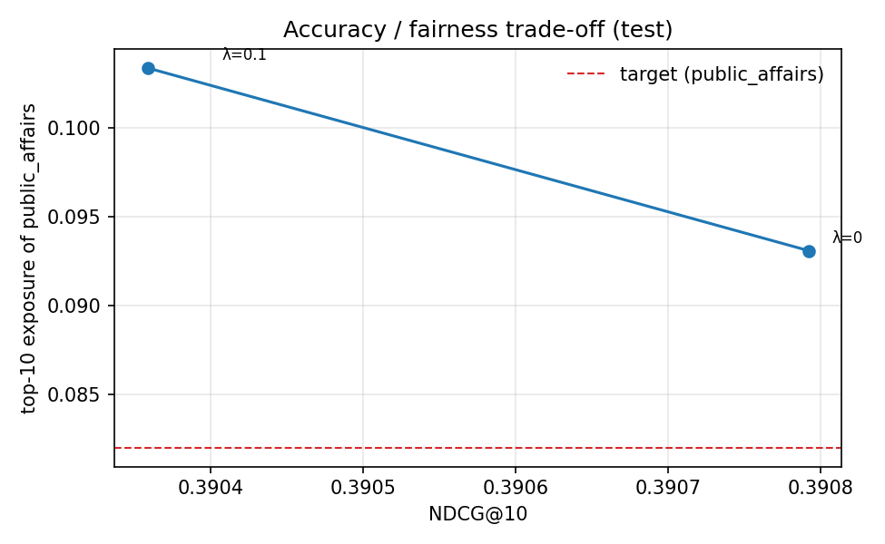

# Experiment on the test split (2656 feeds)

Evaluated feeds: 1512 of 2656 (1144 excluded: no read in the attribution window). Neural + SCRUF-D uses lambda 0.1.

Generated by `python -m agora.experiment --split test`. IPS-NDCG weights each read by 1 / P(seen | displayed position) (propensities from the training split). Top-10 overlap: mean Jaccard overlap of the top 10 between readers who received the same candidates (114 shared candidate sets); 1 = everyone gets the same list.

| Ranking | NDCG@10 | Recall@20 | IPS-NDCG@10 | Top-10 overlap between readers | Top-10 exposure public_affairs | Top-10 exposure environment |
| --- | --- | --- | --- | --- | --- | --- |
| Random | 0.3134 | 0.7896 | 0.2763 | 0.2467 | 0.082 | 0.048 |
| Most popular (article) | 0.3501 | 0.7787 | 0.2758 | 1.0000 | 0.063 | 0.232 |
| Topic popularity | 0.3290 | 0.8293 | 0.3076 | 0.9519 | 0.061 | 0.000 |
| Logistic regression | 0.4203 | 0.8665 | 0.3753 | 0.4689 | 0.078 | 0.032 |
| Neural (NRMS-style) | 0.3908 | 0.8699 | 0.3481 | 0.8440 | 0.093 | 0.140 |
| Neural + SCRUF-D | 0.3904 | 0.8699 | 0.3475 | 0.8388 | 0.103 | 0.140 |

Supplementary public_affairs metrics at 5 (only reads of politics count as relevant; 458 feeds with at least one such read):

| Ranking | NDCG@5 public_affairs | Recall@5 public_affairs | Top-5 exposure public_affairs |
| --- | --- | --- | --- |
| Random | 0.1139 | 0.1925 | 0.083 |
| Most popular (article) | 0.0421 | 0.0932 | 0.032 |
| Topic popularity | 0.0000 | 0.0000 | 0.000 |
| Logistic regression | 0.1575 | 0.2086 | 0.076 |
| Neural (NRMS-style) | 0.0401 | 0.0953 | 0.031 |
| Neural + SCRUF-D | 0.0664 | 0.1550 | 0.046 |

Declared comparisons (A − B; paired bootstrap over readers, 2,000 resamples, seed 42, 95% CI):

| A | B | NDCG@10 | Recall@20 |
| --- | --- | --- | --- |
| Neural (NRMS-style) | Random | +0.0774 [+0.0630, +0.0923] | +0.0802 [+0.0649, +0.0951] |
| Neural (NRMS-style) | Most popular (article) | +0.0407 [+0.0260, +0.0562] | +0.0911 [+0.0738, +0.1079] |
| Neural (NRMS-style) | Topic popularity | +0.0618 [+0.0489, +0.0742] | +0.0406 [+0.0268, +0.0550] |
| Neural (NRMS-style) | Logistic regression | -0.0295 [-0.0444, -0.0137] | +0.0034 [-0.0097, +0.0156] |
| Neural + SCRUF-D | Neural (NRMS-style) | -0.0004 [-0.0014, +0.0005] | +0.0000 [+0.0000, +0.0000] |

Targets: public_affairs 0.082 (share of test candidates 0.081); environment 0.048 (share of test candidates 0.047).

## Lambda sweep (neural + SCRUF-D)

| lambda | NDCG@10 | IPS-NDCG@10 | Exposure public_affairs | Exposure environment |
| --- | --- | --- | --- | --- |
| 0 | 0.3908 | 0.3481 | 0.093 | 0.140 |
| 0.1 | 0.3904 | 0.3475 | 0.103 | 0.140 |

## Three readers before / after SCRUF-D

### Reader `sbgBBeZLcBWWaieYb`, feed `sbgBBeZLcBWWaieYb_20231203022222`
Training history: 68 reads, mostly business (12), politics (10), lifestyle (10).

| Rank with SCRUF-D | Rank without | Article | Topic |
| --- | --- | --- | --- |
| 1 | 1 | 'Brexit has ruined my business - I've lost so many customers' | lifestyle |
| 2 | 2 | Lula’s bid to style himself climate leader at Cop28 undermined by Opec | environment |
| 3 | 7 | Marbles row leaves diplomats reassessing Sunak's strategic grip | politics |
| 4 | 15 | Will the UK smoking ban happen? Rishi Sunak's new law, explained | politics |
| 5 | 16 | The British MPs tobacco firms love to work with | politics |
| 6 | 3 | Australia says AI will be used to help track Chinese submarines under  | world |
| 7 | 4 | Thousands of lives at risk if Sunak rolls back smoking ban, health exp | health |
| 8 | 17 | Sunak in green 'shift' after net zero u-turn to show he 'cares about c | politics |
| 9 | 5 | Israel-Gaza war: Residents of Khan Younis say Israeli strikes heaviest | world |
| 10 | 18 | Rishi Sunak faces a right-wing rebellion over his smoking ban | politics |

### Reader `cB8cpMLHWonFa9GeE`, feed `cB8cpMLHWonFa9GeE_20231207020906`
Training history: 20 reads, mostly lifestyle (4), business (3), politics (3).

| Rank with SCRUF-D | Rank without | Article | Topic |
| --- | --- | --- | --- |
| 1 | 1 | An heiress bride and the groom facing prison: Madelaine Brockway's 'we | lifestyle |
| 2 | 2 | Taylor Swift fans react to true star of Time Person of the Year cover  | lifestyle |
| 3 | 3 | Earth on verge of five catastrophic climate tipping points, scientists | environment |
| 4 | 4 | News anchor praised for 'outstanding' on-air response to body-shamer a | health |
| 5 | 16 | Tamworth and Mid Beds by-election results: Three key points to watch f | politics |
| 6 | 5 | What is whooping cough? Disease quickly spreads across UK | health |
| 7 | 6 | Neighbours report hearing daughter screaming in aftermath of fatal Hac | crime |
| 8 | 7 | UN hears accounts of sexual violence during 7 October attacks by Hamas | world |
| 9 | 8 | Mike Pence reportedly on list to testify at Trump's Georgia election t | world |
| 10 | 9 | Venice gondola capsizes after tourists refuse to sit down and stop tak | world |

### Reader `XNwXo8BYwmJzAbeaD`, feed `XNwXo8BYwmJzAbeaD_20231204020856`
Training history: 29 reads, mostly sport (8), tech_science (4), uk_news (4).

| Rank with SCRUF-D | Rank without | Article | Topic |
| --- | --- | --- | --- |
| 1 | 1 | How to get a state pension if you've never paid National Insurance | lifestyle |
| 2 | 2 | Interest rate decision: Inflation is more stubborn than any toddler, a | lifestyle |
| 3 | 3 | How TikTok could rescue retail by bringing Gen Z back to the high stre | lifestyle |
| 4 | 4 | Exit strategy: why I'll be saying no to a funeral | lifestyle |
| 5 | 5 | Three things with Genesis Owusu: 'With this game everyone becomes Loga | lifestyle |
| 6 | 6 | Cop28 officials fail to clarify if protesters are safe to protest in D | environment |
| 7 | 14 | UK has lacked coherent economic strategy for years, thinktank finds | politics |
| 8 | 7 | Police reveal what was in drug-laced chocolate bars that were sold to  | crime |
| 9 | 8 | Israel divides Gaza into numbered blocks telling Palestinians to move  | world |
| 10 | 9 | Police 'concerned' after young woman seen being carried into car in Sc | crime |

