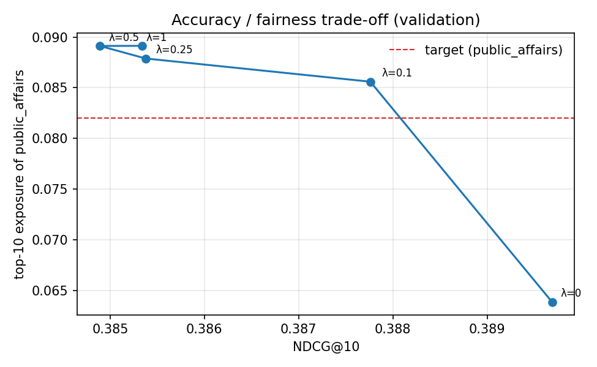

# Experiment on the validation split (1620 feeds)

Evaluated feeds: 1106 of 1620 (514 excluded: no read in the attribution window). Neural + SCRUF-D uses lambda 0.1.

Generated by `python -m agora.experiment --split validation`. IPS-NDCG weights each read by 1 / P(seen | displayed position) (propensities from the training split). Top-10 overlap: mean Jaccard overlap of the top 10 between readers who received the same candidates (6 shared candidate sets); 1 = everyone gets the same list.

| Ranking | NDCG@10 | Recall@20 | IPS-NDCG@10 | Top-10 overlap between readers | Top-10 exposure public_affairs | Top-10 exposure environment |
| --- | --- | --- | --- | --- | --- | --- |
| Random | 0.3091 | 0.7778 | 0.2713 | 0.2461 | 0.082 | 0.049 |
| Most popular (article) | 0.4043 | 0.8040 | 0.3066 | 1.0000 | 0.028 | 0.238 |
| Topic popularity | 0.3251 | 0.7904 | 0.3049 | 0.9390 | 0.068 | 0.000 |
| Logistic regression | 0.4231 | 0.8652 | 0.3653 | 0.4231 | 0.053 | 0.108 |
| Neural (NRMS-style) | 0.4127 | 0.8324 | 0.3674 | 0.8542 | 0.056 | 0.140 |
| Neural + SCRUF-D | 0.4087 | 0.8333 | 0.3629 | 0.8175 | 0.086 | 0.140 |

Supplementary public_affairs metrics at 5 (only reads of politics count as relevant; 291 feeds with at least one such read):

| Ranking | NDCG@5 public_affairs | Recall@5 public_affairs | Top-5 exposure public_affairs |
| --- | --- | --- | --- |
| Random | 0.1402 | 0.2242 | 0.081 |
| Most popular (article) | 0.0389 | 0.0833 | 0.032 |
| Topic popularity | 0.0013 | 0.0034 | 0.005 |
| Logistic regression | 0.0878 | 0.1569 | 0.041 |
| Neural (NRMS-style) | 0.0201 | 0.0427 | 0.020 |
| Neural + SCRUF-D | 0.1139 | 0.2632 | 0.067 |

Declared comparisons (A − B; paired bootstrap over readers, 2,000 resamples, seed 42, 95% CI):

| A | B | NDCG@10 | Recall@20 |
| --- | --- | --- | --- |
| Neural (NRMS-style) | Random | +0.1037 [+0.0872, +0.1192] | +0.0546 [+0.0351, +0.0717] |
| Neural (NRMS-style) | Most popular (article) | +0.0085 [-0.0085, +0.0260] | +0.0284 [+0.0109, +0.0459] |
| Neural (NRMS-style) | Topic popularity | +0.0876 [+0.0726, +0.1018] | +0.0420 [+0.0234, +0.0599] |
| Neural (NRMS-style) | Logistic regression | -0.0104 [-0.0261, +0.0056] | -0.0328 [-0.0484, -0.0181] |
| Neural + SCRUF-D | Neural (NRMS-style) | -0.0040 [-0.0062, -0.0018] | +0.0009 [+0.0000, +0.0028] |

Targets: public_affairs 0.082 (share of validation candidates 0.082); environment 0.048 (share of validation candidates 0.048).

## Lambda sweep (neural + SCRUF-D)

| lambda | NDCG@10 | IPS-NDCG@10 | Exposure public_affairs | Exposure environment |
| --- | --- | --- | --- | --- |
| 0 | 0.4127 | 0.3674 | 0.056 | 0.140 |
| 0.1 | 0.4087 | 0.3629 | 0.086 | 0.140 |
| 0.25 | 0.4057 | 0.3608 | 0.089 | 0.135 |
| 0.5 | 0.4053 | 0.3606 | 0.090 | 0.136 |
| 1 | 0.4052 | 0.3604 | 0.090 | 0.136 |

## Three readers before / after SCRUF-D

### Reader `Ag4pnn5Qj3uzQspeW`, feed `Ag4pnn5Qj3uzQspeW_20231202023014`
Training history: 46 reads, mostly culture (8), world (5), health (5).

| Rank with SCRUF-D | Rank without | Article | Topic |
| --- | --- | --- | --- |
| 1 | 1 | Third of teachers now retire early, losing GBP 4,500 a year from their | lifestyle |
| 2 | 2 | From serums to sex toys, why the craze for luxury advent calendars jus | lifestyle |
| 3 | 3 | 'Forever chemical' in English tap water samples carcinogenic, WHO rule | environment |
| 4 | 4 | Strictly's Amy Dowden shares health update after being rushed to hospi | health |
| 5 | 5 | Rita Moreno says she combats loneliness by making friends at grocery s | health |
| 6 | 16 | Starmer hardens language on Israel-Gaza war after mass Labour Party re | politics |
| 7 | 6 | The war has resumed - but who started it again is of little consequenc | world |
| 8 | 7 | Police probe mystery sheep deaths as remains found strewn across garde | crime |
| 9 | 8 | 'There is nowhere to go': Israeli bombing resumes in besieged Gaza | world |
| 10 | 9 | 'Walking pneumonia' in China as serious infections spike in many natio | tech_science |

### Reader `5KGm3v6TQCHnNeY37`, feed `5KGm3v6TQCHnNeY37_20231130022647`
Training history: 12 reads, mostly tech_science (3), lifestyle (2), crime (2).

| Rank with SCRUF-D | Rank without | Article | Topic |
| --- | --- | --- | --- |
| 1 | 1 | Money Clinic: Should I bother investing my GBP 20k now savings rates h | lifestyle |
| 2 | 2 | I've discovered my pension is invested in cigarette and arms firms - s | lifestyle |
| 3 | 5 | Watch again: Sunak faces Starmer at PMQs as UK suffers economic blow | politics |
| 4 | 3 | From tree planting to ‘sponge cities’: why nature-based solutions are  | environment |
| 5 | 4 | Megan Fox says she's raising her sons so they are 'not like men that I | health |
| 6 | 6 | Murder accused threatened to 'batter' teenager before her death, trial | crime |
| 7 | 16 | London politics watch LIVE: Starmer says Sunak has 'lost his marbles'  | politics |
| 8 | 7 | Preacher convicted of fraud over bogus Covid cure loses appeal | crime |
| 9 | 8 | Iran execution of child condemned by UN human rights office | world |
| 10 | 9 | Australian populations of threatened bird species fall 60% in past 40  | world |

### Reader `26ab9wY6m3bABg4At`, feed `26ab9wY6m3bABg4At_20231201073017`
Training history: 56 reads, mostly uk_news (11), tech_science (8), politics (7).

| Rank with SCRUF-D | Rank without | Article | Topic |
| --- | --- | --- | --- |
| 1 | 1 | When will I get the warm home discount? How to get GBP 150 off bills t | lifestyle |
| 2 | 2 | The new 'scramble for Africa': how a UAE sheikh quietly made carbon de | environment |
| 3 | 12 | Two Premier League footballers playing while facing abuse investigatio | politics |
| 4 | 3 | NHS urges people to book 'lifesaving' Covid and flu vaccines before Ch | health |
| 5 | 4 | Father who saw toddler daughter killed by runaway Range Rover fighting | crime |
| 6 | 5 | 'It's like a nightmare': Desperate 999 call by dog walker who found Br | crime |
| 7 | 6 | 'We stand against genocide': Gaza peace protesters target New York Chr | world |
| 8 | 7 | Madeleine McCann suspect to stand trial on five separate sexual assaul | crime |
| 9 | 8 | Met officer who Tasered 10-year-old girl twice cleared of misconduct | crime |
| 10 | 9 | Mother of 18-month-old boy and partner found guilty of murder | uk_news |

